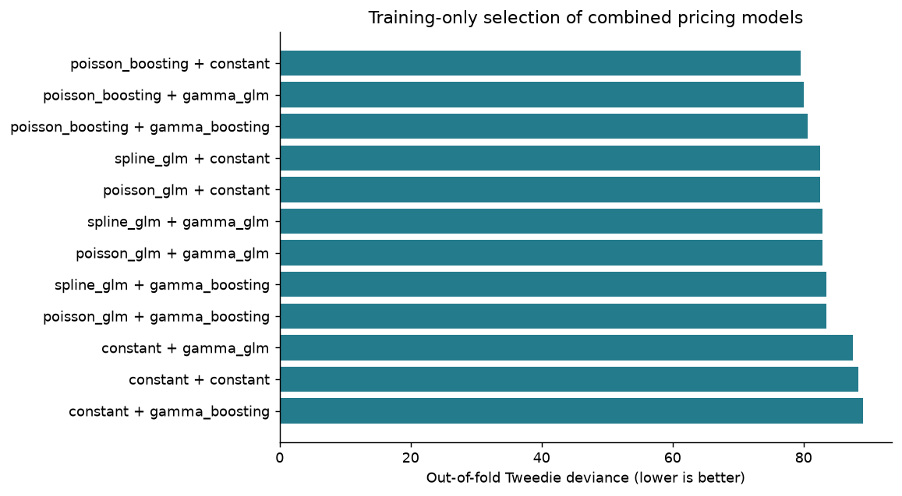
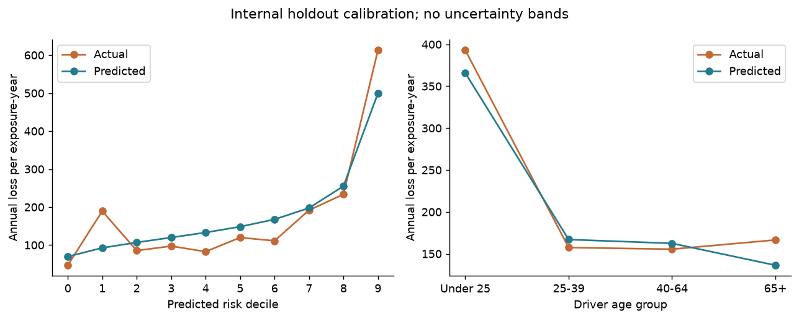
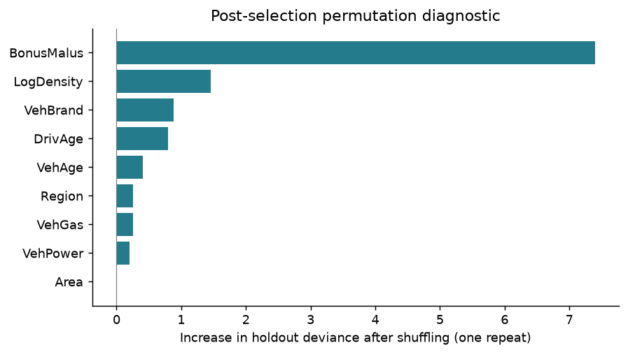
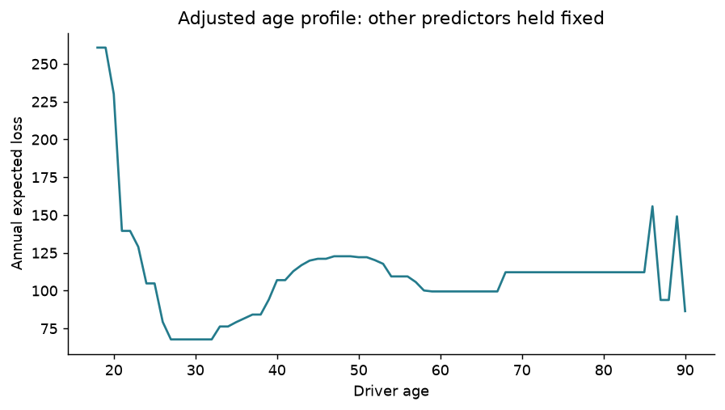
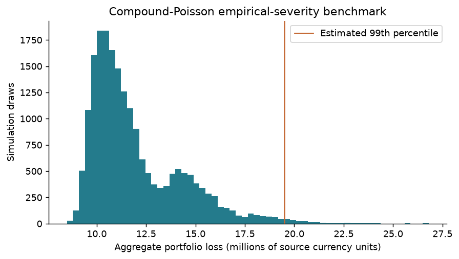

# Motor Insurance Expected-Loss Study

FULL PORTFOLIO. Generated from an executed run; seed 42, 3 policy folds.

## Business question and conclusion

Can policy characteristics improve expected claim-cost allocation relative to charging one portfolio-wide loss rate?
The training-selected combination is **poisson_boosting + constant**. Its internal-holdout Tweedie deviance is
**80.601**, compared with **86.496** for the flat baseline
(6.82% improvement; negative means deterioration). Actual/expected total cost is **0.991**.
The paired bootstrap interval is below zero, supporting an improvement over the flat baseline under this resampling scheme.

This is an educational expected-loss analysis, not a production tariff or independent external validation.
The portfolio and earlier splits have already been explored in this repository. The selection procedure uses training folds only,
but the reused data cannot be described as a previously untouched external test set.

## Data and reconciliation

- Source: OpenML freMTPL2 frequency (41214) and severity (41215); provenance: raw OpenML tables.
- Original policies: 678,013; original claim records: 26,639.
- Claim records without matching policies: 195; excluded positive cost: 788,714.18.
- Excluded invalid policies: 0; total positive claim cost excluded through unmatched/invalid policies: 788,714.18.
- Training policies: 542,410; holdout policies: 135,603; training claims: 21,044.
- Exposure cap: 1.0; altered exposure records: 1,224.
- Policies with reported-versus-positive-record count discrepancies before any development sampling: 9,117.
- Training largest claim: 4,075,400.56; top 1% of training claims contribute 38.6% of training claim cost.

The target is the number of positive claim-amount records linked to each policy. ClaimNb is retained for reconciliation,
not used as a predictor or silently assumed equivalent. Zero matched positive claims means zero observed positive-record loss,
not proof that no report, unpaid claim, or missing payment exists. Nonpositive claim records are excluded and counted in the audit.
No claim-count or claim-cost caps are used in model fitting. Exposure capping is a documented modeling assumption;
use the separate uncapped run to assess it. Raw values remain available.

## Modeling and validation

Annual frequency is fitted to positive count / exposure with exposure weights. Severity is fitted on individual positive training claims.
Their product estimates annual pure premium; multiplying by exposure estimates cost over the recorded coverage period.
Models compare a constant, regularized Poisson GLM, spline Poisson GLM and Poisson boosting for frequency;
constant severity, regularized Gamma GLM and Gamma boosting for severity.
All 12 combinations use common out-of-fold policy predictions and the same Tweedie metric (power 1.5).
Preprocessing is fitted inside each training fold. All claims belonging to one policy share its fold.
Candidate settings and the metric power are fixed, not tuned using holdout results. The selected combination is refitted on training data only.

| model | tweedie_deviance |
| --- | --- |
| poisson_boosting + constant | 79.5983 |
| poisson_boosting + gamma_glm | 79.9975 |
| poisson_boosting + gamma_boosting | 80.5792 |
| spline_glm + constant | 82.5288 |
| poisson_glm + constant | 82.5521 |
| spline_glm + gamma_glm | 82.8413 |
| poisson_glm + gamma_glm | 82.8751 |
| spline_glm + gamma_boosting | 83.4402 |
| poisson_glm + gamma_boosting | 83.4719 |
| constant + gamma_glm | 87.5756 |
| constant + constant | 88.3216 |
| constant + gamma_boosting | 89.0404 |

Standalone Poisson and Gamma scores are saved in component_cv_folds.csv. Their winners need not give the best combined premium model.
The constant-frequency/constant-severity combination is algebraically the flat loss-rate baseline on each training fold.

## Internal holdout results

| model | tweedie_deviance | actual_cost | predicted_cost | actual_to_expected | mean_absolute_cost_error |
| --- | --- | --- | --- | --- | --- |
| selected | 80.6011 | 11,868,103.8400 | 11,981,300.2853 | 0.9906 | 162.9542 |
| flat_baseline | 86.4963 | 11,868,103.8400 | 11,994,398.9841 | 0.9895 | 167.5975 |

Tweedie deviance measures prediction error with zeros and positive continuous losses; lower is better.
Actual/expected near one measures total calibration, not whether individual policies are priced well.
Mean absolute cost error is a secondary diagnostic and can favor predictions too low for estimating expected insurance losses.
Risk deciles contain approximately equal policy counts rather than equal exposure.

| metric | estimate | lower_95 | upper_95 |
| --- | --- | --- | --- |
| selected_minus_baseline_tweedie | -5.8952 | -10.4081 | -2.6834 |
| selected_actual_to_expected | 0.9906 | 0.8293 | 1.1862 |

Intervals use 500 paired policy bootstrap replicates conditional on the fitted models.
They exclude refitting/selection uncertainty, temporal drift and systematic source-data errors. The deviance difference is selected minus baseline;
negative favors the selected model. No confidence bands are implied by the calibration lines.

## Interpretation

Shuffling shows which variables the fitted combination relies on. One permutation per variable is a descriptive check;
correlated features can share importance, negative values are possible, and this is not a causal or significance analysis.
Holdout diagnostics must not be used to silently retune the model and still claim an untouched holdout.

This holds other predictors at training medians/modes. The saved CSV records that reference profile.
It represents associations for one constructed profile and may contain sparse or unusual combinations.
GLM coefficients, when present, are penalized coefficients: scaled numeric multipliers are per training standard deviation,
and spline/category coefficients are basis/coding dependent rather than standalone causal rate factors.

## Aggregate-loss simulation and stresses

The simulation is a **constant-severity benchmark** using the selected frequency component and empirical training claim amounts.
It is not a simulation of conditional Gamma severity when that model is selected.
The base analytical mean is 11,981,300.29; simulated mean is 11,964,344.82,
with Monte Carlo standard error 16,506.46.
Its estimated 95th and 99th percentiles are 16,522,416.62 and 19,493,468.63.

| scenario | analytical_mean | simulated_mean | percentile_95 | percentile_99 |
| --- | --- | --- | --- | --- |
| base | 11,981,300.2853 | 11,964,344.8221 | 16,522,416.6235 | 19,493,468.6284 |
| severity_plus_10pct | 13,179,430.3139 | 13,160,779.3044 | 18,174,658.2858 | 21,442,815.4912 |
| frequency_plus_10pct | 13,179,430.3139 | 13,165,371.9433 | 17,824,392.3210 | 20,813,050.4911 |

The stresses are transparent hypothetical 10% changes, not forecasts. There are 20,000 draws per scenario;
about 200 draws lie above the empirical 99th percentile. More draws reduce Monte Carlo error,
but cannot repair assumptions. Independent Poisson counts, independent empirical severities, and fixed fitted parameters
exclude common shocks, extra count dispersion, parameter uncertainty and unseen claim severities beyond the training maximum.
Analytical variance is lambda times the empirical second severity moment; the simulation is checked against these moments.
The severity-cap sensitivity file illustrates how much the mean would change under hypothetical payment caps;
it is not evidence for discarding genuine large claims and does not refit the models.

## Recommendation and limitations

Use the study to demonstrate SQL reconciliation, exposure-aware GLMs, model comparison, calibration and risk communication.
Before operational use, obtain independent/time-based validation, verify quote-time availability of BonusMalus and other predictors,
investigate claim-count discrepancies and count dispersion, and assess conditional severity/dependence and extreme-loss behavior.
No claim-development, trend, inflation or coverage-limit adjustments are available here. Monetary results remain in source units.
No premium data exist for loss ratios or profitability. Expenses, commission, tax, profit and capital loadings are outside scope.
Do not describe the simulated percentiles as regulatory capital estimates.

## Reproduction and artifacts

Run `python setup_database.py`, then `python run_analysis.py`. Repeating the same analysis command resumes verified checkpoints.
To reproduce this exact configuration, use the source SHA-256, package versions and settings in manifest.json;
include `--sample`, `--seed`, `--folds`, `--simulations`, `--bootstrap` and `--uncapped-exposure` when differing from defaults.
Use a new output directory after changing data, code or settings. Never load untrusted joblib files.
The results.sqlite database contains policy predictions and calibration tables for further SQL work.

Methodological reference: [scikit-learn insurance example](https://scikit-learn.org/stable/auto_examples/linear_model/plot_tweedie_regression_insurance_claims.html).
Dataset pages: [frequency](https://www.openml.org/d/41214), [severity](https://www.openml.org/d/41215).
