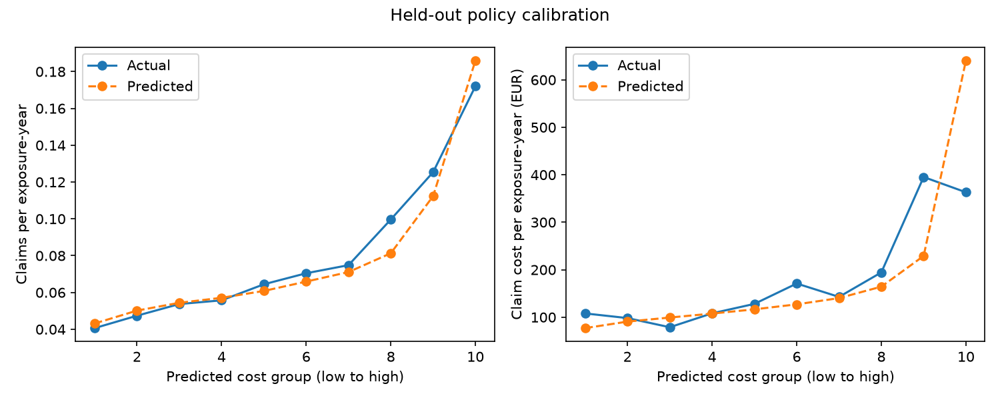

# Motor insurance pricing analysis

Can a few policy characteristics improve expected claim-cost estimates over one flat rate?

## Data and approach

- Source: OpenML French motor frequency (41214) and severity (41215) datasets.
- 678,013 source policies; 0 excluded for missing/invalid predictors or exposure.
- 195 claims have no matching source policy; 0 nonpositive claim records. These records are excluded.
- 9,117 retained policies have reported counts different from matched positive claim records. Frequency here counts matched positive records, keeping it consistent with severity and total loss.
- 542,410 training policies, 135,603 held-out policies, seed 42. All claims on a policy stay together.
- Predictors: driver age band, vehicle age/power, bonus-malus, area and fuel type.
- Poisson GLM for annual claim frequency; Gamma GLM with log link for individual positive claim amounts. Fixed small ridge penalties stabilize coefficients; no tuning or model search.
- Annual expected claim cost = frequency × severity. Multiply by exposure for the observed coverage period.
- Baseline: training claim count / exposure × training mean severity. No exposure or loss caps.

## Held-out results

| Model | Frequency deviance | Cost deviance | Expected cost (EUR) | Actual / expected |
| --- | ---: | ---: | ---: | ---: |
| Flat baseline | 0.4859 | 86.48 | 11,994,481 | 0.989 |
| Poisson + Gamma | 0.4677 | 83.97 | 11,652,819 | 1.018 |

Actual held-out cost: **EUR 11,868,104**. Lower deviance is better; cost deviance uses Tweedie power 1.5, weighted by exposure.

Frequency deviance improvement over baseline: **3.73%**.
Cost deviance improvement over baseline: **2.90%** (negative means worse).
An actual/expected ratio above 1 means the model underestimates total cost.

The chart groups policies by predicted cost. It checks whether predicted rates follow observed rates across risk groups; matching the total alone is insufficient.

## Interpretation and limitations

The frequency model follows the observed rise across risk groups reasonably well. Cost calibration is less consistent: the highest predicted-cost group is overestimated, while the next group is underestimated. The overall deviance comparison therefore does not imply accurate estimates for every group.

Large claims can dominate severity estimates and make cost calibration noisy. This random internal holdout does not measure future-year performance. Age bands and penalties were fixed in advance; the holdout was not used for tuning.

These are expected claim costs, not commercial premiums: expenses, profit, inflation, claim development and coverage differences are omitted. Independence and the Poisson count assumption are simplifications. Policy predictor availability at quotation time also needs checking before any real pricing use.
